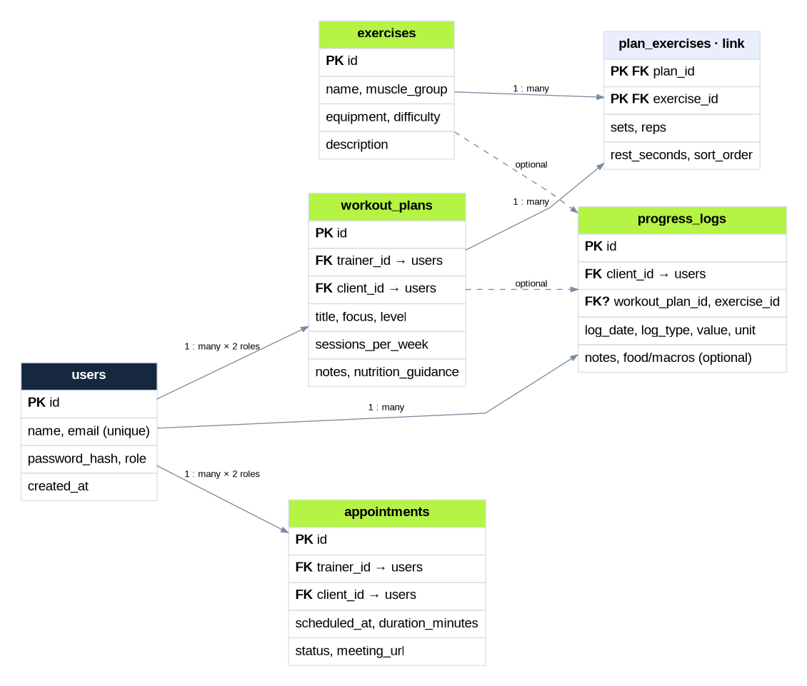

# Draft ERD — FitTrack Connect (Milestone 1)

The source version is [`ERD.mmd`](./ERD.mmd), which can be edited with Mermaid Live Editor or Mermaid in GitHub Markdown.

## Five core entities

1. **users** — registered account; roles are `admin`, `trainer`, `client`.
2. **workout_plans** — trainer-created routine assigned to one client; includes written nutrition / meal guidance.
3. **exercises** — reusable library of exercise definitions.
4. **progress_logs** — client events for body weight, water, training, and optionally a food with nutritional information.
5. **appointments** — virtual personal-training sessions between one trainer and one client.

### Relationship table (not a sixth primary feature)

**plan_exercises** — a junction table because a workout plan has many exercises and each exercise can appear in many plans. It holds workout-specific sets, reps, rest time and order. The application therefore has five core feature entities and six SQL tables.

### Cardinalities and constraints

- One trainer (user) creates 0..N workout plans. Each plan has exactly one trainer and one assigned client (user). Role constraints checked by the service layer.
- One client (user) owns 0..N progress log entries. The plan and exercise references in a log are optional, e.g. a water log has no particular exercise.
- One trainer and one client participate in each appointment; each can be associated with 0..N appointments.
- One plan contains 0..N exercise links; one exercise can belong to 0..N plans.
- `email` is unique. Passwords will be stored only as hashes (no plain text passwords).
- Nutrition info from the external API is stored (if chosen) in `progress_logs` as an entry's name/reference and selected nutrient values. All nutrients depend on the portion and the API's estimate; they are not guaranteed to be exact.
- The schema is **a draft**, not an actual MySQL database yet. Types, normalization, constraints and sample seed data will be finalized in Milestone 2.

### Scope note

A separate, structured `meal_plans` entity can be added later if there is time. The M1–M4 core scope remains the original five entities; meanwhile, trainers can put meal guidance in each workout plan and clients can log food through the nutrition page.
